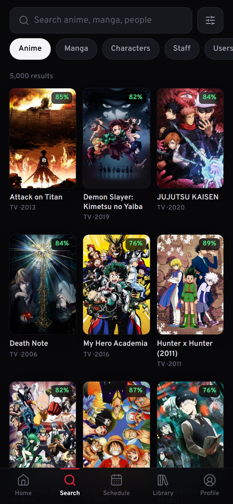
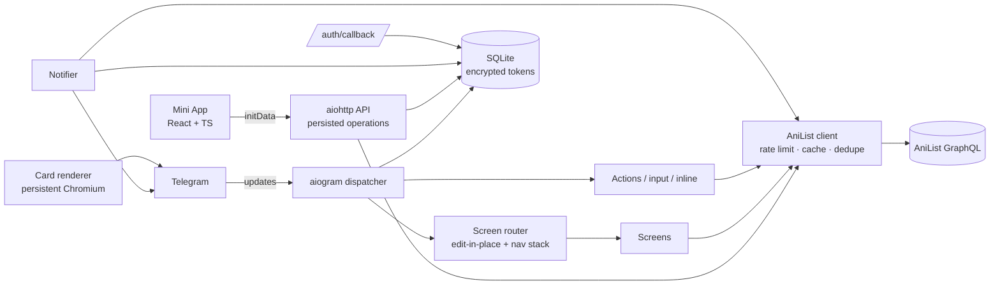

<div align="center">


# AniList for Telegram

**The most complete AniList client for Telegram — a fast bot, smart notifications, shareable cards and a full Mini App.**

[](https://github.com/Westyasha/AniList_Telegram/actions/workflows/ci.yml)


[**Open the bot →**](https://t.me/westyasha_AniList_bot)

</div>

---

## Highlights

- **One message, no clutter.** Every menu is a screen that edits itself in place. Back navigation survives restarts.
- **Real list management.** Status, `+1 episode` from anywhere, rewatch counting, notes, removal — and scores in *your* AniList score format (100 / 10.0 / 10 / ★5 / 🙂3).
- **Notifications that are right.** Checked every 5 minutes, sent only for episodes that actually aired, deduplicated in the database, per-status toggles, sequel/spin-off alerts and AniList follows, likes and replies relayed to Telegram.
- **Crisp profile card in under a second.** A persistent Chromium renders 2400 px cards from prefetched full-size images (was ~8 s at 1200 px). Cached by content hash, re-sent instantly by `file_id`.
- **AniList Wrapped.** A story-format yearly recap built from your real activity: episodes, hours, monthly chart, top genres and titles.
- **Telegram Mini App.** AniList-style home, search with filters, weekly schedule, library with a full entry editor, profile statistics, notifications inbox.
- **Proper login.** OAuth authorization-code flow with a confirmation page — no copy-pasting tokens.
- **Fully bilingual.** Russian and English everywhere: bot, cards, auth pages, Mini App, command menu.
- **Inline mode.** Share any anime, what you're watching, or your profile card in any chat.

## Screenshots

| Home | Title | Profile |
|:---:|:---:|:---:|
|  |  |  |

| Schedule | Search | Wrapped |
|:---:|:---:|:---:|
|  |  |  |

<div align="center">

<br><sub>Profile card — 2400 px, rendered in under a second and cached by content hash</sub>
</div>

## How it compares

| | This project | lostb053/anibot | Fazendaaa/AnilistBot |
|---|:---:|:---:|:---:|
| Search anime, manga, characters, staff, users | ✅ | partial | inline only |
| Edit list: status, progress, score, notes | ✅ | status only | local list |
| Respects the user's score format | ✅ | — | — |
| Airing alerts from AniList data, deduplicated | ✅ | scraped sources | own scheduler |
| AniList follows / likes / replies in Telegram | ✅ | — | — |
| OAuth login without copying codes | ✅ | PIN | — |
| Profile card, Wrapped, statistics | ✅ | basic | — |
| Telegram Mini App | ✅ | — | — |
| In-place message navigation | ✅ | — | — |

## Architecture



```
app/
├── anilist/        GraphQL client, queries, OAuth, helpers
├── bot/
│   ├── navigation.py   screen router and in-place rendering
│   ├── screens/        home, search, media, library, browse, profile, settings, auth, help
│   └── handlers/       commands, actions, input, cards, inline, errors
├── db/             schema, migrations, repositories, FSM storage
├── i18n/           ru.toml, en.toml
├── services/       notifier, cards (renderer, templates, fonts), auth
└── web/            Mini App API, OAuth pages
webapp/             Telegram Mini App (Vite, React, TypeScript, Tailwind)
deploy/             systemd unit, nginx config, deploy script
tests/              pytest suite
```

### Design notes

- **Screens are routes.** Callback data like `/m/154587` resolves to a builder that returns `Screen(text, keyboard, image)`. The image is rendered as a large link preview above the text, so every screen is a text message that can always be edited.
- **AniList rate limits.** The API currently allows 30 requests per minute. A shared sliding-window limiter, `Retry-After` handling, response caching and in-flight request deduplication keep the bot inside that budget.
- **Security.** AniList tokens are encrypted at rest (Fernet). Mini App requests are authenticated by validating Telegram `initData` (HMAC-SHA256, freshness check) and can only run allow-listed GraphQL operations with per-user rate limits. OAuth `state` is a single-use nonce bound to the Telegram user, and the final step shows both accounts before linking.

## Self-hosting

### Requirements

- Python 3.12+, Node 20.19+
- A bot token from [@BotFather](https://t.me/BotFather)
- An AniList API client from [anilist.co/settings/developer](https://anilist.co/settings/developer) with the redirect URL `https://<your-domain>/auth/callback`
- A domain with HTTPS for the Mini App and OAuth callback

### Local run

```bash
git clone https://github.com/Westyasha/AniList_Telegram.git
cd AniList_Telegram
python -m venv .venv && source .venv/bin/activate
pip install -r requirements-dev.txt
playwright install chromium
cp .env.example .env
python -m app
```

Mini App development server (proxies `/api` to the bot backend):

```bash
cd webapp
npm install
VITE_API_PROXY=http://127.0.0.1:8090 npm run dev
```

### Docker

```bash
cp .env.example .env
docker compose up -d --build
```

### Production (systemd + nginx)

```bash
sudo useradd --system --home-dir /opt/anilist-telegram anilist
sudo git clone https://github.com/Westyasha/AniList_Telegram.git /opt/anilist-telegram
sudo cp deploy/anilist-bot.service /etc/systemd/system/
sudo cp deploy/nginx.conf /etc/nginx/sites-available/anilist
sudo systemctl enable anilist-bot
sudo /opt/anilist-telegram/deploy/deploy.sh
```

### Configuration

| Variable | Required | Description |
|---|:---:|---|
| `BOT_TOKEN` | ✅ | Telegram bot token |
| `SECRET_KEY` | ✅ | Long random string used to encrypt AniList tokens |
| `ANILIST_CLIENT_ID` | ✅ | AniList API client id |
| `ANILIST_CLIENT_SECRET` | ✅ | AniList API client secret |
| `ANILIST_REDIRECT_URI` | | `https://<domain>/auth/callback`; the PIN URL enables the copy-code fallback |
| `PUBLIC_URL` | | Public HTTPS origin of the Mini App and OAuth pages |
| `WEB_HOST`, `WEB_PORT` | | Backend bind address, default `127.0.0.1:8090` |
| `DATABASE_PATH` | | SQLite file, default `data/bot.db` |
| `LEGACY_DATABASE_PATH` | | Old `users.db` to import once, default `users.db` |
| `NOTIFIER_INTERVAL` | | Seconds between notification checks, default `300` |
| `LOG_LEVEL` | | Default `INFO` |

## Development

```bash
ruff check app tests && ruff format app tests
pytest -q
cd webapp && npm run lint && npm run build
```

## Acknowledgements

Built on the excellent [AniList GraphQL API](https://docs.anilist.co) and its [documentation](https://github.com/AniList/docs). Not affiliated with AniList.
